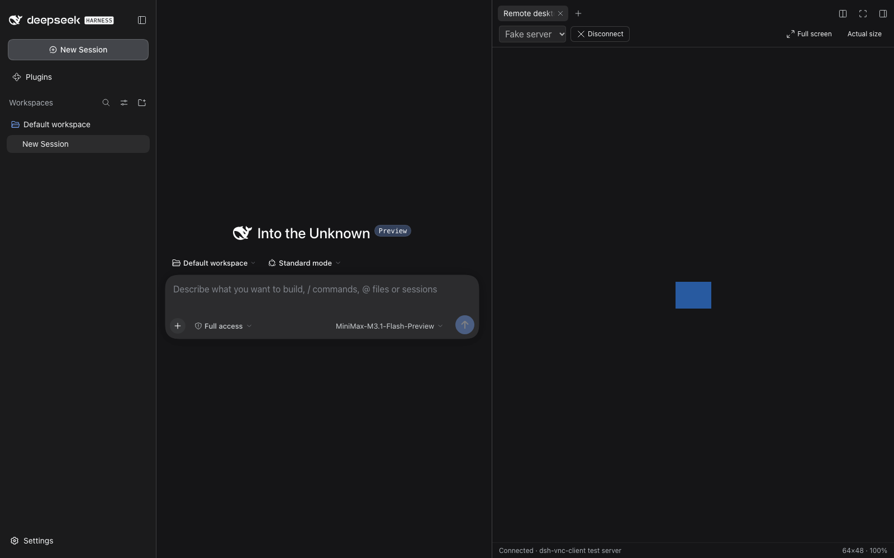
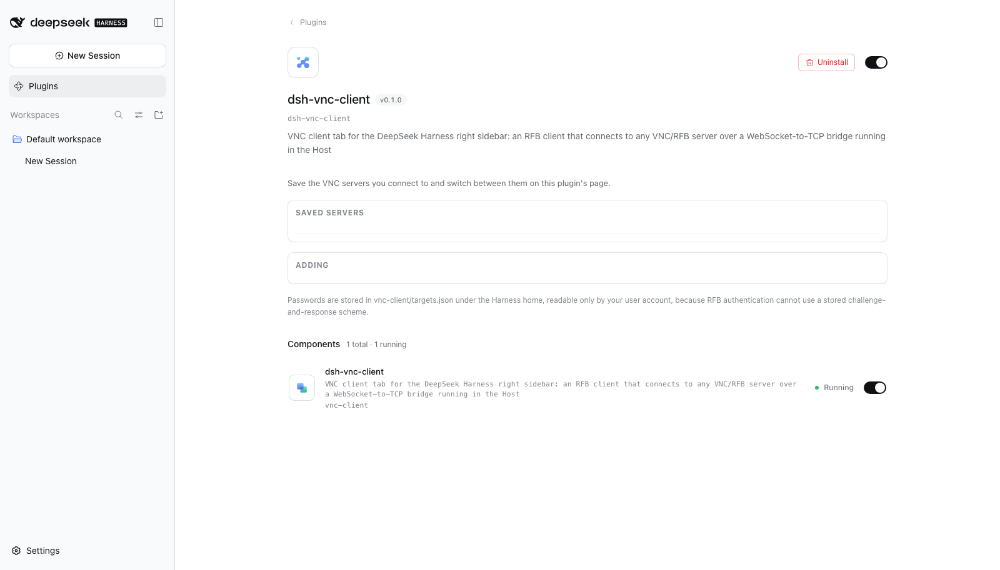

# dsh-vnc-client

A VNC client tab for the [DeepSeek Harness](https://github.com/deepseek-ai) right sidebar.

It connects to **any** VNC/RFB server — not just the machine the harness runs on — through a
WebSocket-to-TCP bridge that runs in the Harness Host. Servers are saved from the plugin's own
page under **Settings → Plugins → dsh-vnc-client**.



## Install

```sh
dsh plugin --profile <profile> add dsh-vnc-client
```

Then restart the harness. A plugin bundle is composed at boot, so the tab does not appear until
the Host restarts.

To connect the sidebar guide's **Remote desktop** entry to a specific server, open
**Settings → Plugins → dsh-vnc-client**, add the server, and click **Test** to confirm it
answers before switching to it.

## What it does

- Opens a **Remote desktop** tab in the right sidebar, beside Files, Preview and Terminal.
- Speaks RFB 3.3/3.7/3.8 directly in the browser: Raw, CopyRect, Hextile, Tight and ZRLE
  rectangles; DesktopSize, ExtendedDesktopSize, LastRect and Cursor pseudo-encodings.
- Sends keyboard and pointer events back to the server, plus wheel, the server's cursor
  shape, and clipboard in both directions.
- Saves servers with an optional VNC password.



## How it is put together

A DSH plugin is two halves in one package:

| Half | Where | What it does |
| --- | --- | --- |
| Host | `src/host/index.js` | Mounts a WebSocket upgrade route and a `TypertRemoteService` for saving servers |
| Client | `src/client/app.js` | Registers the sidebar tab type, the settings seats, and the guide command |

A browser cannot open a raw TCP socket, so the Host accepts a WebSocket at
`/api/vnc/bridge?target=<id>` — authenticated by the same connection check the Gateway uses —
and pumps bytes to and from the VNC server. **The password is never put in the URL**: it travels
over the RPC channel and is resolved by the Host at connect time, so it stays out of access logs.

Servers live in `vnc-client/targets.json` under the Harness home, written `0600` in a `0700`
directory. The list RPC reports only whether a password is set, never the password itself.

### Encodings

`DecompressionStream` emulates persistent zlib, because Tight and ZRLE keep deflate state across
rectangles and a browser has no incremental inflater. VNC authentication needs DES, which Node
dropped and WebCrypto never had, so `src/client/rfb/des.js` implements it.

JPEG is deliberately **not** advertised: a Tight JPEG rectangle cannot be painted without a
separate decoder, and offering it would make the client pick an encoding it cannot draw.

## Development

```sh
node scripts/build.mjs     # src/ → lib/
node --test "test/*.test.mjs"
```

`scripts/build.mjs` inlines the client's ES modules into the single factory body the harness
loads, and refuses to build a bundle containing a `jsx` call React would silently render as
nothing — a null props object, or children passed as trailing arguments where the runtime expects
a key. Both fail in the browser as an empty sidebar tab, far from the call that caused them.

The tests cover DES against FIPS vectors and OpenSSL, every supported encoding round-tripped
through an independently written encoder, the handshake against a real socket (including
one-byte-at-a-time fragmentation), the WebSocket server against Node's own client, and the
built bundle's contract.

## Licence

MIT — see [LICENSE](LICENSE).
